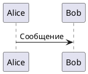

# UMBRA Docs

Отдельный репозиторий проектной документации UMBRA: требований, моделей,
архитектурных решений и материалов кейса системного анализа. Портал собирается
MkDocs Material, а PlantUML-диаграммы рендерятся только локальным контейнером.

Содержательные разделы добавляются по мере появления подтверждённых решений.
Пустые аналитические страницы и каталоги не создаются.

## Технологический стек

- Python 3.14.2;
- MkDocs 1.6.1 и Material for MkDocs 9.8.2;
- `mkdocs_puml` 2.3.0;
- PlantUML Server 1.2026.6 в Docker;
- GitHub Actions и GitHub Pages.

Все Python-зависимости зафиксированы в `requirements.txt`, версия контейнера —
в `compose.yml`. Java и Graphviz на хостовую ОС устанавливать не требуется.

## Системные требования

- Git;
- Python 3.14.2 с модулем `venv`;
- Docker с поддержкой Docker Compose;
- свободные локальные порты `8080` для PlantUML и `8000` для MkDocs.

Команды выполняются из корня репозитория.

## Клонирование

```bash
git clone git@github.com:Valerkamade/umbra-docs.git
cd umbra-docs
```

Для клонирования без SSH-ключа:

```bash
git clone https://github.com/Valerkamade/umbra-docs.git
cd umbra-docs
```

## Установка на Windows в Git Bash

```bash
py -3.14 -m venv .venv
source .venv/Scripts/activate
python -m pip install --upgrade pip
python -m pip install -r requirements.txt
```

## Установка на Windows в PowerShell

```powershell
py -3.14 -m venv .venv
.\.venv\Scripts\Activate.ps1
python -m pip install --upgrade pip
python -m pip install -r requirements.txt
```

Если PowerShell запрещает запуск скрипта активации, для текущего процесса можно
выполнить:

```powershell
Set-ExecutionPolicy -Scope Process -ExecutionPolicy Bypass
```

## Установка на macOS и Linux

```bash
python3.14 -m venv .venv
source .venv/bin/activate
python -m pip install --upgrade pip
python -m pip install -r requirements.txt
```

## Локальный запуск

Запустите PlantUML Server:

```bash
docker compose up -d plantuml
docker compose ps
```

Сервер доступен только с хоста по адресу `http://127.0.0.1:8080/`.
После его готовности запустите портал:

```bash
python -m mkdocs serve
```

Откройте адрес, который выведет MkDocs. Из-за заданного `site_url` локальный
маршрут содержит префикс `/umbra-docs/`.

Остановка сервисов:

```bash
docker compose down
```

MkDocs останавливается сочетанием `Ctrl+C`.

## Проверка сборки

При запущенном PlantUML выполните:

```bash
python -m mkdocs build --strict
python scripts/check_diagrams.py site
```

Первая команда проверяет конфигурацию, навигацию и внутренние ссылки. Вторая
подтверждает, что PlantUML-блоки заменены SVG и в результате нет известных
признаков ошибки рендеринга. Результат сборки создаётся в `site/` и не
коммитится.

## Диаграммы

Inline-диаграмма оформляется блоком `puml`:

````markdown

````

Для отдельного исходника сохраните UTF-8-файл в `docs/assets/diagrams/`, затем
подключите его из Markdown:

````markdown
```puml
--8<-- "assets/diagrams/example.puml"
```
````

Локальный hook `hooks/plantuml_files.py` разворачивает ссылку до запуска
`mkdocs_puml`. Путь ограничен каталогом `docs/`; отсутствие файла завершает
сборку ошибкой. Для читаемости в обеих цветовых схемах используйте прозрачный
фон и монохромный режим, как в тестовой диаграмме. Не используйте внешние
`!include` и публичные PlantUML-серверы без отдельного согласования.

Кэш SVG хранится в `.cache/plantuml/` и не коммитится.

## Структура репозитория

```text
umbra-docs/
├── .github/
│   ├── workflows/
│   │   ├── ci.yml
│   │   └── deploy.yml
│   └── pull_request_template.md
├── docs/
│   ├── assets/diagrams/
│   ├── stylesheets/
│   └── index.md
├── hooks/
│   └── plantuml_files.py
├── scripts/
│   └── check_diagrams.py
├── compose.yml
├── mkdocs.yml
├── requirements.txt
├── .gitignore
├── CONTRIBUTING.md
└── README.md
```

## Автоматические проверки и публикация

Pull Request в `main` запускает `.github/workflows/ci.yml`: workflow поднимает
тот же контейнер PlantUML, ожидает готовности с тайм-аутом, выполняет строгую
сборку и проверяет SVG.

Push в `main` запускает `.github/workflows/deploy.yml`. После тех же проверок
каталог `site/` загружается как артефакт GitHub Pages и публикуется официальным
`actions/deploy-pages`; ветка `gh-pages` и `mkdocs gh-deploy` не используются.

Ожидаемый стандартный адрес после включения Pages:
`https://valerkamade.github.io/umbra-docs/`. Фактическая публикация должна быть
подтверждена в GitHub. Домен `docs.umbraspace.ru` на этом этапе не подключается.

## Типовые ошибки

### PlantUML недоступен

Проверьте состояние и журнал контейнера:

```bash
docker compose ps
docker compose logs plantuml
```

Убедитесь, что Docker Desktop запущен, а порт `8080` свободен. На Windows ошибка
доступа к `docker_engine` означает, что текущая сессия не имеет доступа к Docker
Desktop; перезапустите Docker Desktop и терминал с подходящими правами.

### Порт уже занят

Остановите конфликтующий процесс или контейнер. Порт нельзя произвольно менять
только в `compose.yml`: тот же адрес указан в `mkdocs.yml` и workflows.

### Диаграмма заменена сообщением об ошибке

Проверьте синтаксис `.puml`, кодировку UTF-8 и наличие `@startuml`/`@enduml`.
Затем очистите локальный кэш и повторите сборку:

```bash
rm -rf .cache/plantuml
python -m mkdocs build --strict
python scripts/check_diagrams.py site
```

В PowerShell для очистки кэша:

```powershell
Remove-Item -Recurse -Force -LiteralPath .cache\plantuml
```

### Строгая сборка сообщает об ошибке ссылки

Используйте относительные ссылки на Markdown-файлы, например
`[Описание](section/page.md)`, и проверьте существование целевого заголовка.

## Внесение изменений

Правила GitHub Flow, именования веток, Conventional Commits, связи с Jira,
Pull Request и версионирования описаны в [CONTRIBUTING.md](CONTRIBUTING.md).
